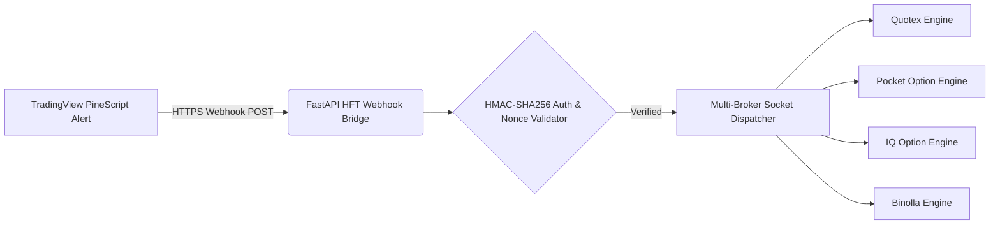

# ⚡ TradingView PineScript HFT Webhook Bridge to Multi-Broker APIs

> **Ultra-low latency TradingView alert receiver & asynchronous trade execution router for Quotex, Pocket Option, IQ Option & Binolla.**

[](https://t.me/+R_kEsY9yqkA1NDI1)
[](https://t.me/YouKnowWho_am)
[](https://api1.api.cbtradersbd.com/docs)
[](https://api1.api.cbtradersbd.com/docs)

---

## 🚀 Architectural Overview



---

## ✨ System Highlights

- **Sub-10ms Webhook Routing:** Built on asynchronous Python (Uvicorn + uvloop) with minimal latency from alert reception to socket delivery.
- **HMAC-SHA256 Cryptographic Guard:** Prevents unauthorized spoofed alert payloads using tokenized secret signatures.
- **Dynamic Multi-Account Splitter:** Mirror an alert to multiple broker accounts simultaneously with customizable risk percentages.
- **Native PineScript v5 Template:** Included institutional indicators (OrderBlock, Fair Value Gap, Liquidity Sweep) pre-configured with JSON payload dispatch.

---

## 🛠️ Quickstart

```bash
# Clone the repository
git clone https://github.com/cbtradersbd/tradingview-pinescript-hft-webhook-bridge.git
cd tradingview-pinescript-hft-webhook-bridge

# Install dependencies
pip install -r requirements.txt

# Run webhook latency benchmark
python examples/test_webhook_alert.py
```

---

## 🏷️ Search & Index Tags
`tradingview-webhook` • `pinescript-alerts` • `quotex-webhook` • `pocketoption-webhook` • `binolla-webhook` • `iq-option-webhook` • `hft-execution` • `fastapi` • `algorithmic-trading` • `binary-bot`


---

## 🌐 CB Traders BD Ecosystem : Explore All Broker APIs & Bots

Cross-platform algorithmic trading, real-time Decrypted Sub-Millisecond Binary Feeds, and AI signal engines:

| Platform | Official Official High-Frequency Binary Protocol & REST API | Signals & Telegram Bots | Data Tools & Bridges |
| :--- | :--- | :--- | :--- |
| **Quotex** | [Quotex-API](https://github.com/cbtradersbd/Quotex-API) | [quotex-otc-signal-engine](https://github.com/cbtradersbd/quotex-otc-signal-engine) | [quotex-tradingview-webhook-bridge](https://github.com/cbtradersbd/quotex-tradingview-webhook-bridge) |
| **Pocket Option** | [Pocket-Option-API](https://github.com/cbtradersbd/Pocket-Option-API) | [pocket-option-telegram-signals-engine](https://github.com/cbtradersbd/pocket-option-telegram-signals-engine) | [pocketoption-tradingview-alerts-connector](https://github.com/cbtradersbd/pocketoption-tradingview-alerts-connector) |
| **IQ Option** | [IQ-Option-API](https://github.com/cbtradersbd/IQ-Option-API) | [iq-option-telegram-signal-bot](https://github.com/cbtradersbd/iq-option-telegram-signal-bot) | [iq-option-market-data-api](https://github.com/cbtradersbd/iq-option-market-data-api) |
| **Binolla** | [Binolla-API](https://github.com/cbtradersbd/Binolla-API) | [binolla-live-signals-bot](https://github.com/cbtradersbd/binolla-live-signals-bot) | [binolla-tradingview-webhook-bot](https://github.com/cbtradersbd/binolla-tradingview-webhook-bot) |

---

## 💼 Commercial Bot Orders & Custom Development
Looking for an automated TradingView PineScript bridge, institutional multi-broker router, or custom HFT webhook server?
- 💬 **Direct Telegram Contact**: [@YouKnowWho_am](https://t.me/YouKnowWho_am)
- 📢 **Official Telegram Channel**: [CB Traders BD](https://t.me/+R_kEsY9yqkA1NDI1)
- 🤖 **AI Signal Bot Demo**: [https://t.me/cbsignalsproai_bot?start=1](https://t.me/cbsignalsproai_bot?start=1)
- 🛡️ **Trader Verification Bot**: [https://t.me/cbtradersbd_bot?start=1](https://t.me/cbtradersbd_bot?start=1)
- 🌐 **Interactive API Documentation**: [https://api1.api.cbtradersbd.com/docs](https://api1.api.cbtradersbd.com/docs)

---

## ⭐ Star This Project
If you find this open-source trading toolkit valuable, please give it a **Star on GitHub** to support active development!
<!-- last_verified_sync: 1793078595 -->
